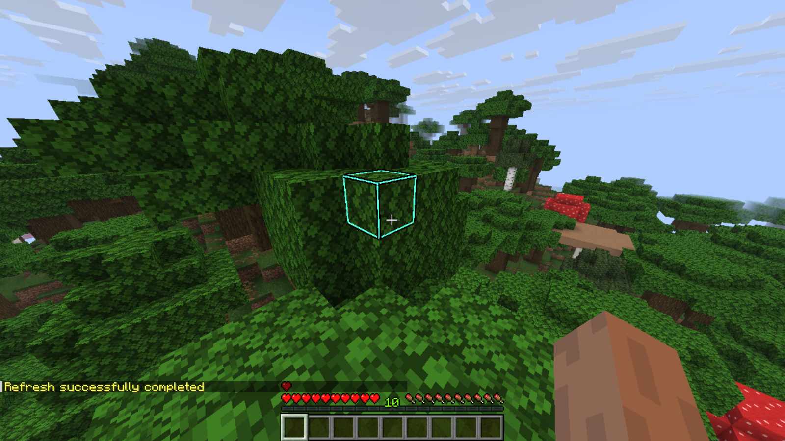
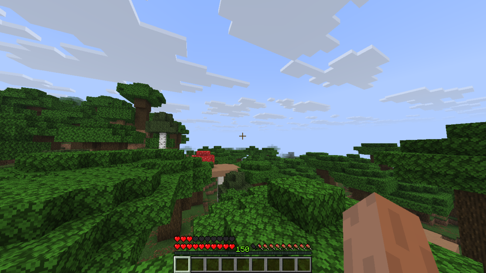
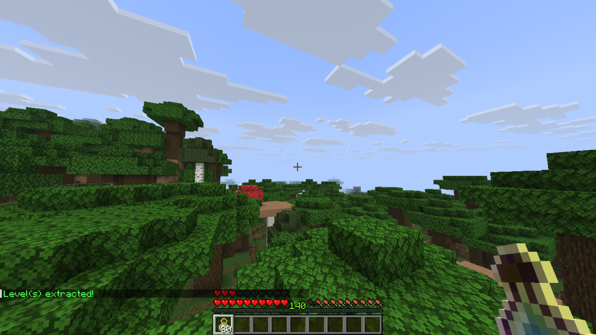

# Levels MC
Plugin for PaperMC Minecraft servers that overhauls XP levels

## Download
- Download from GitHub Releases [here]()
- Download from Modrinth [here]()

## Features
- Every 10 levels, you gain an extra heart, up to 20 hearts by default
- Commands to extract XP, 250XP per 10 levels you sacrifice above level 20 by default
- Transfer XP directly to other people

## Installation Guide
1. Have a PaperMC server set up. For guidance on setting up the server, go to the [PaperMC Documentation](https://docs.papermc.io/paper/getting-started/)
2. Download the plugin from one of the [Download Links](#download) above
3. Put the plugin in the plugins folder
4. This plugin only works server side. 300 downloads and I'll make a client-side mod.

## Usage Tutorial
- When a player gets to 10 levels, they gain an extra heart. This continues every 10 levels until the player reaches the maximum, which is 20 by default
- The heart count should update automatically, but if it's stuck, players can run `/refresh` to update their heart count
- Players can run `/extract` to extract XP levels to XP bottles, at an exchange rate of 3 bottles per level. This can only be done when the player is at level 10 or higher, and the extraction doesn't bring the player to below 9 levels

## Gallery

## Credits
- [Kody Simpson's PaperMC Plugin Guide](https://www.youtube.com/playlist?list=PLZb14wOLO7NA)
- [PaperMC Documentation](https://docs.papermc.io/)
- Inspired by the [Levels SMP](https://www.youtube.com/@LevelsSMP)
